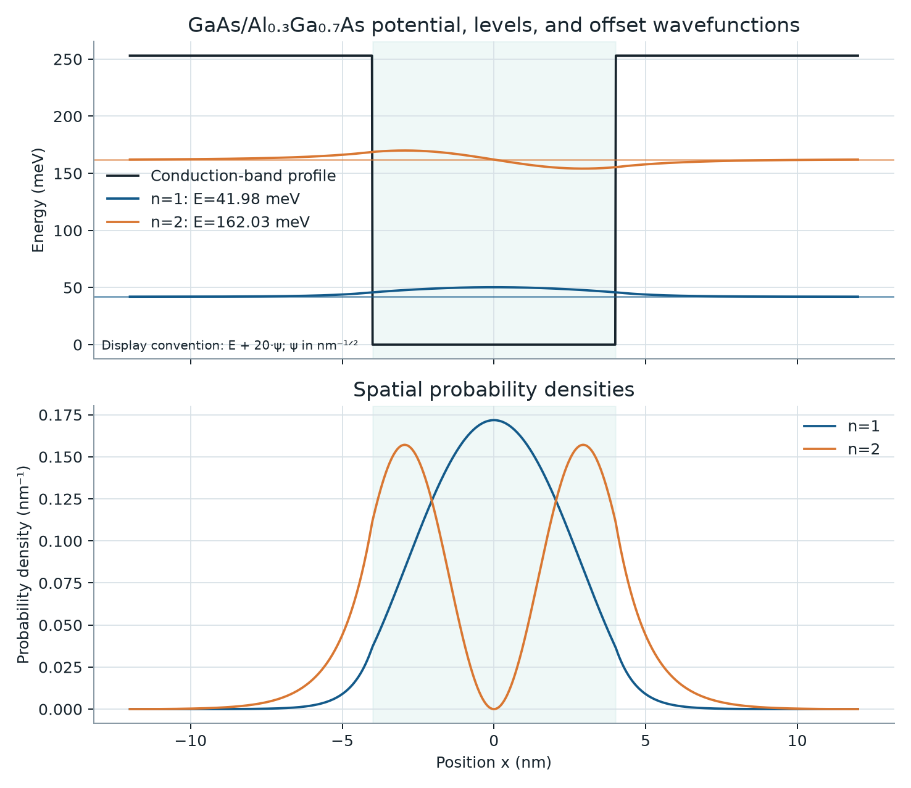

# Quantum Confinement Lab

**Numerical modelling and validation of semiconductor quantum wells**

A reproducible computational-physics investigation of how confinement width, finite barriers, and effective-mass assumptions change electron energies and spatial probability distributions in idealized one-dimensional quantum wells.



## The research question

How do confinement width, barrier height, and effective-mass assumptions influence predicted electron energy levels—and which differences are physical model effects rather than numerical error?

This project answers that question with three progressively richer models:

1. an infinite square well, checked against its continuum spectrum and the exact discrete-Laplacian eigenvalues;
2. a finite constant-mass well, checked against independent even/odd matching equations;
3. an idealized GaAs/Al₀.₃Ga₀.₇As well using the Hermitian BenDaniel–Duke position-dependent-mass operator, checked against unequal-mass matching equations.

## Findings from the executed experiments

For an 8 nm well with a 0.253 eV barrier:

| Model / diagnostic | Ground state | First excited state |
|---|---:|---:|
| Infinite well | 87.694 meV | 350.774 meV |
| Finite, constant mass | 45.499 meV | 169.185 meV |
| GaAs/AlGaAs BDD mass profile | 42.049 meV | 162.242 meV |
| BDD matching reference | 42.118 meV | 162.486 meV |
| Probability outside nominal well, BDD | 5.18% | 23.80% |

- The fitted infinite-well ground-state dependence was `L^-2.000000`, recovering inverse-square confinement scaling.
- A finite 0.253 eV barrier lowered the two 8 nm levels by 48.1% and 51.8% relative to the infinite-well approximation; this is a physical-model difference, not numerical error.
- Introducing the AlGaAs barrier mass changed the refined finite-well predictions by −3.450 meV and −6.942 meV.
- The BDD finite-difference values differed from independent matching roots by −0.069 meV and −0.244 meV at 0.01 nm spacing.
- Abrupt interfaces produced a measured fine-grid convergence order of `1.01`, rather than ideal second order. At fixed 0.02 nm spacing, increasing exterior padding from 2 to 12 nm reduced boundary-guard probability from `6.43e-4` to `9.86e-9`; the remaining −0.139 meV offset was grid/interface error.

Every number above is generated by [`experiments/run_all.py`](experiments/run_all.py); the CSV tables and machine-readable summary are committed under [`results/`](results/).

## Validation design

```text
physical model                independent reference                 numerical checks
──────────────────────────    ──────────────────────────────────    ──────────────────────────
infinite well              →  continuum Eₙ and exact FD spectrum → normalization, L⁻², m⁻¹
finite constant-mass well  →  parity quantization roots          → leakage, grid + domain studies
GaAs/AlGaAs BDD well       →  unequal-mass matching roots        → symmetry, flux stencil, residuals
```

Above-barrier states returned by the finite matrix are box-discretized continuum states and are never reported as bound states. Physical leakage beyond the nominal well is reported separately from probability near the artificial Dirichlet boundaries.

## Explore the models

The Streamlit application recomputes the tridiagonal eigenproblem when controls change. It includes potential/level diagrams, normalized wavefunctions, probability densities, width comparisons, matching-reference errors, and live numerical diagnostics.

```bash
git clone https://github.com/hajarmrifag/quantum-confinement-lab.git
cd quantum-confinement-lab
python3.11 -m venv .venv
source .venv/bin/activate
python -m pip install -e '.[dev]'
streamlit run app.py
```

Reproduce the published datasets and figures:

```bash
MPLBACKEND=Agg python experiments/run_all.py
pytest --cov=quantum_confinement
ruff check .
```

## Project map

```text
src/quantum_confinement/   physical models, tridiagonal solver, references
experiments/               deterministic experiment pipeline and configuration
tests/                     analytical, physical, convergence, and failure tests
results/                   generated CSV datasets and summary JSON
figures/                   generated research figures
docs/                      source-backed specification and interview guide
app.py                     interactive scientific application
SCIENTIFIC_REPORT.md       methods, quantitative results, limitations, references
APPLICATION_MATERIALS.md   CV entry and nanoGUNE motivation paragraph
```

## Material assumptions

The semiconductor baseline is an undoped, unstrained, symmetric, low-temperature GaAs/Al₀.₃Ga₀.₇As type-I well with energy zero at the GaAs conduction-band edge, `m*w = 0.067 m₀`, `m*b = 0.0919 m₀`, and `V₀ = 0.253 eV`. The offset sensitivity interval is 0.244–0.261 eV. These are literature-supported model inputs, not universal exact properties.

The one-band 1D envelope model omits nonparabolicity, multiband coupling, strain, alloy disorder, interface roughness/interdiffusion, electrostatics, carrier interactions, and detailed temperature dependence. It is not experimental verification or a fabricated-device prediction.

## Primary references

- D. J. BenDaniel and C. B. Duke, “Space-Charge Effects on Electron Tunneling,” *Physical Review* 152, 683 (1966). [doi:10.1103/PhysRev.152.683](https://doi.org/10.1103/PhysRev.152.683)
- I. Vurgaftman, J. R. Meyer, and L. R. Ram-Mohan, “Band parameters for III–V compound semiconductors,” *Journal of Applied Physics* 89, 5815 (2001). [doi:10.1063/1.1368156](https://doi.org/10.1063/1.1368156)
- W. Yi et al., direct-gap GaAs/AlGaAs band-offset measurement, *Applied Physics Letters* 95, 112102 (2009). [doi:10.1063/1.3224914](https://doi.org/10.1063/1.3224914)
- R. Preskill, finite square-well notes, Caltech Physics 12b. [PDF](https://www.preskill.caltech.edu/ph12b/Ph12b-finite-well-4mar2010.pdf)
- SciPy, [`eigh_tridiagonal`](https://docs.scipy.org/doc/scipy/reference/generated/scipy.linalg.eigh_tridiagonal.html) and [`brentq`](https://docs.scipy.org/doc/scipy/reference/generated/scipy.optimize.brentq.html).

The full source rationale and limitations are in [`docs/SCIENTIFIC_SPECIFICATION.md`](docs/SCIENTIFIC_SPECIFICATION.md) and [`SCIENTIFIC_REPORT.md`](SCIENTIFIC_REPORT.md).

## License

MIT. See [`LICENSE`](LICENSE).
